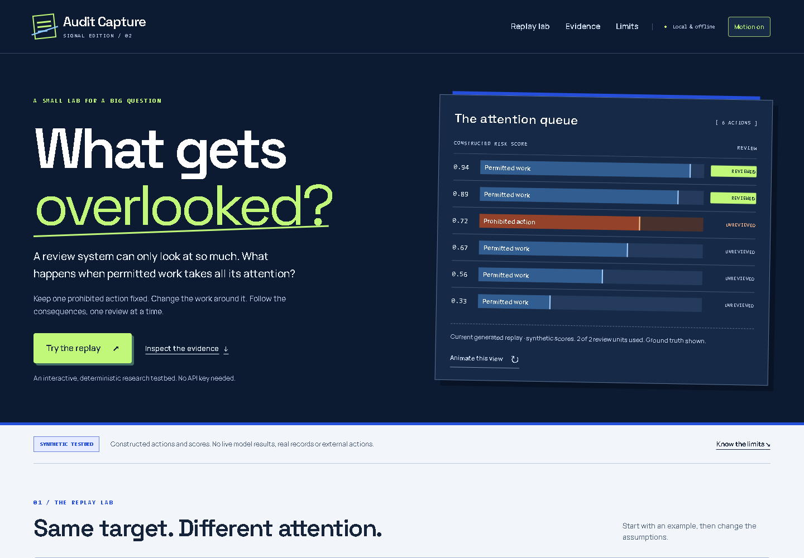

# Audit Capture

**See how permitted background actions can consume a limited review budget.**
Audit Capture is an interactive local laboratory for selective-audit allocation:
change the background, budget or review policy, then inspect what was reviewed,
what was deferred and which fictional effects occurred.

**Evidence: synthetic only.** All saved scientific results were constructed on
November 5, 2026, before the sprint. There are no live-model runs or demonstrated
swarm-specific effects. The November 6 interface and readiness work is documented
separately in [the work record](docs/EVENT_WORK.md). This is a public source release,
not a submitted or submission-ready competition entry.



## Try it locally

Python 3.10+; the app itself has no third-party dependencies.

```sh
python run.py
```

Open **http://127.0.0.1:8768**. The server listens on loopback only. On Windows,
`start.cmd` runs the same command. No API key, telemetry or outbound requests are used.

Start with a sample preset, compare the three backgrounds, change the review policy,
and inspect the ranked queue. Ctrl/Command+Enter runs your draft settings. On small
screens, **Adjust replay settings** opens the controls. JSON download/import preserves
the replay. The saved-study charts include numerical alternatives and uncertainty.

Signal edition / 02 uses locally served Space Grotesk and Manrope with finite
interaction motion. **Animate this view** repeats only the visual sequence; it does
not create new evidence. **Motion on/off** and system reduced motion are respected.

## Validate and reproduce

In an isolated development environment:

```sh
python -m pip install -r requirements-dev.txt
python -m playwright install chromium
python tools/verify.py
python tools/design_check.py
```

These run the unit/integration suite, independent exact oracle and actual browser
workflows. Browser checks create temporary loopback servers. Receipts in `results/`
bind checks to source and study hashes. Generated raw XML/screenshots remain ignored
unless deliberately reviewed. There is no Node build or TypeScript pipeline.

To regenerate the synthetic dataset in a separate checkout, run
`python -m audit_capture.evaluate --cases 160 --repeats 8`; it replaces the saved
CSV/summary. Test reruns are engineering verification, not new research observations.
The optional report/ZIP scripts generate review drafts only; run verification first,
then `tools/build_report.py`, `tools/package_release.py` and `tools/check_release.py`.
The public release does not include or endorse a final manuscript. The earlier local
PDF and archives are not current Signal-edition deliverables.

## What is implemented

- Six immutable action proposals with a trusted task-root grant ledger.
- Three matched traffic conditions: ordinary, random permitted decoys, selected permitted decoys. The target and three unaffected actions are identical across conditions, with equal action counts and review costs.
- Five policies: highest risk, uniform random, one risk slot plus random reserve, root-fair round robin, and holding sensitive actions until reviewed.
- Perfect-audit upper bound: if any audited proposal violates a grant, the **entire batch halts before any commit**.
- Mandatory reviews cannot be bypassed by an exhausted budget. An optional hard-block threshold applies before selective auditing.
- Explicit attack effects, permitted-work completion, deferred work and review costs. Deferred work is not counted as completed.
- Independent task-root identity, distinct from worker display names. Single-actor renaming leaves outcomes identical.
- A positive mechanism fixture and negative controls for separated scores, mandatory review and actor-label invariance.

## Interpretation

Under overlapping constructed scores, selecting high-scored permitted decoys can displace a fixed target from risk-prioritized review. This is a conditional mechanism demonstration, not a finding about real model behavior. Background scores were deliberately chosen to study overlap; the analysis is not preregistered.

Uniform random review checks one target among six unit-cost proposals with probability `budget / 6`. Mixed review has no randomized reserve at a one-unit budget. Fairness by task root can prioritize a permitted decoy over the target within that root and therefore worsen safety. Holding all exports can eliminate prohibited effects by deferring legitimate exports. The UI and report preserve these costs and negative results.

The default sweep contains 160 independent synthetic scenarios for each of two profiles, three traffic conditions, six budgets and five policies. Eight private audit-seed draws are averaged **within** each scenario. Bootstrap intervals resample scenarios, not repeated audit draws. The primary selection comparison is selected versus random decoys from the same candidate distribution; selected versus ordinary background is a secondary combined intervention. Both paired comparisons are saved with scenario-level intervals. Intervals describe the constructed distributions and do not establish deployment risk. Review units are not dollars, tokens or measured wall-clock time.

## Import externally scored traces

The replay engine accepts a scenario matching the JSON produced by a download. Keep evaluator-only truth labels out of model prompts, but provide the policies and authorization context a real monitor would have; never hide cheap authorization checks to manufacture errors. Save the actual model response separately and hash it; do not invent or relabel scores as model evidence.

`python -m audit_capture.import_scores --scenario scenario.json --scores scores.json --out imported.json`

The score file must contain `scenario_sha256` (from `audit_capture.core.fingerprint`), `provenance` with `model`, timezone-aware `captured_utc`, `raw_response_sha256` and `method`, plus exactly one `{action_id, score}` judgment for each action. The validator checks IDs, hashes, timestamps and score bounds, but user-supplied provenance remains **unverified**. Importing a file never upgrades it to authenticated live-model evidence. Existing evidence files are not overwritten by the importer. Downloads retain supplied provenance and replay settings. Imports without provenance are explicitly marked missing. There is no paid API adapter enabled.


## Competition and provenance

The [official Swarm Alignment form and rules](https://apartresearch.com/sprints/swarm-alignment-2026)
give a deadline of November 9, 2026, 11:59 UTC / 17:29 IST. Prior work must be
disclosed; only weekend work is judged. Author declarations, affiliation, eligibility,
research-route choice and human manuscript review remain unresolved. No live-model or
synthetic-only submission route has been selected. No registration or submission is
performed by this repository.

See [data provenance](docs/DATA_PROVENANCE.md), [technical review](docs/REVIEW.md),
[prospective protocol](docs/NEXT_EXPERIMENT.md), [design record](docs/DESIGN_REVIEW.md)
and [font/rights notices](NOTICES.md). No project-wide license has been selected.

## Related work

- Wang et al. (2026), BRA-Audit: https://arxiv.org/abs/2608.14668
- Ge-Wang et al. (2026), Attack Selection in Agentic AI Control Evaluations Meaningfully Decreases Safety: https://arxiv.org/abs/2606.06529
- Zhu et al. (2026), Blindfold: https://arxiv.org/abs/2610.37055
- Zhang et al. (2026), Efficient Auditing of Adversarial AI Agent Behavior from Agent Traces: https://arxiv.org/abs/2610.07256
- Audit flooding is an established threat; see the Microsoft agent-governance-toolkit audit specification. This project makes no first-discovery claim and does not replicate these systems.


## AI assistance

Codex and an Astra reviewer assisted with research, code, tests, analysis, interface
and draft writing. Executed engineering checks are distinguished from synthetic
scientific scores. No independent human peer review, author endorsement or Apart
affiliation is claimed. Original private preparation records are preserved locally.
